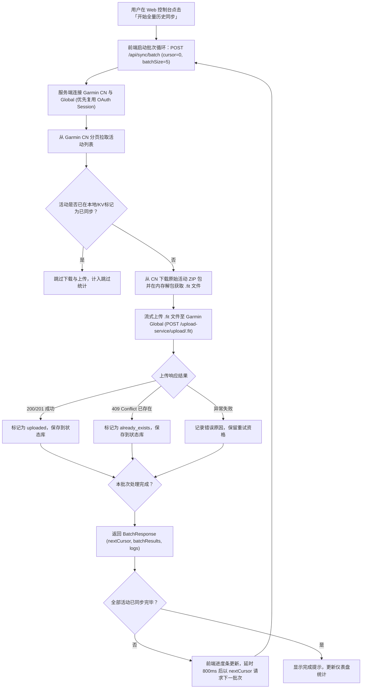

# FitSync - 佳明中国区到国际区运动数据同步引擎

[](https://nextjs.org/)
[](https://www.typescriptlang.org/)
[](https://vercel.com/)
[](https://tailwindcss.com/)

**FitSync** 是根据 [fithub](https://github.com/Sitoi/fithub)（Python 版）以及 [DailySync](https://github.com/deanxizian/DailySync) 项目重新实现的 **TypeScript 全栈版本**。用于将 **Garmin 中国区 (Garmin Connect CN)** 的全部历史运动数据与最新日常数据同步至 **Garmin 国际区 (Garmin Global)**。

基于 **Next.js App Router** 架构开发，支持一键部署到 **Vercel**，并完美解决无服务器（Serverless）运行超时限制。

---

## 🌟 核心特性

- 🚀 **支持全部历史数据同步**：
  - 自动向后分页拉取国区所有历史活动（从最新一直到最初注册的运动记录）。
  - 支持 **全量历史同步**、**增量日常同步** 以及 **失败重试** 三种模式。
- ⚡️ **专为 Vercel 优化（解决 Serverless 超时）**：
  - **分批处理架构 (Batch API)**：单批次处理 3~10 条活动（耗时 ~3-8 秒），严格控制在 Vercel 15 秒限制之内。
  - **前端驱动执行循环**：前端页面以批次为单位平滑迭代调用，实现成百上千条历史记录的连续完整同步，支持随时**暂停 / 继续**。
  - **内存解包与直传**：下载的活动 ZIP 包在内存中通过 `JSZip` 直接提取 `.fit` 二进制数据并流式上传，不依赖本地可写磁盘，完全适配 Vercel 的只读文件系统。
- 🔒 **智能会话与双状态存储**：
  - 支持 Garmin OAuth1 / OAuth2 会话持久化，避免频繁账号密码登录触发风控或验证码。
  - **本地开发**：自动使用本地文件系统存储（`.data/sync_state.json`）。
  - **Vercel 部署**：原生无缝对接 **Upstash Redis / Vercel KV**，数据在多次无服务器调用间持久保存。
  - **网页本地存储**：在浏览器直接输入凭证即可保存在 `localStorage`，无需重新部署即可切换账号。
- 🔁 **智能去重与防抖**：
  - 国际区已存在的运动（HTTP 409 Conflict）自动识别为已同步（跳过），不产生重复记录。
  - 本地状态记录每个活动的运动类型、距离、耗时、时间戳和状态。
- ⏰ **支持 Vercel Cron 定时同步**：
  - 内置 `/api/cron` 端点与 `vercel.json` 定时任务配置，支持每日自动同步最新运动。
- 🖥 **双重运行模式**：
  - 既有现代化 **Web 控制台 Dashboard**（带实时进度条、指标卡片、活动表格与实时终端日志）。
  - 也支持通过 **CLI 命令行** 直接运行。

---

## 📁 项目目录结构

```
fitsync/
├── .env.example               # 环境变量配置模版
├── vercel.json                # Vercel 部署及定时任务 (Cron) 配置文件
├── package.json               # 项目依赖与运行脚本
├── tsconfig.json              # TypeScript 编译配置
├── next.config.ts             # Next.js 与服务端外部包配置
├── src/
│   ├── app/                   # Next.js App Router
│   │   ├── api/
│   │   │   ├── auth/test/     # 账号连接与 OAuth 会话测试
│   │   │   ├── sync/batch/    # 单批次同步核心端点 (Vercel-safe)
│   │   │   ├── sync/status/   # 同步状态与历史列表查询
│   │   │   ├── sync/reset/    # 重置同步记录
│   │   │   ├── cron/          # Vercel Cron 自动化日常同步
│   │   │   └── config/        # 服务器配置状态检测
│   │   ├── layout.tsx         # 全局布局与深色主题
│   │   ├── globals.css        # Tailwind CSS v4 样式
│   │   └── page.tsx           # 现代全功能 Web 控制台仪表盘
│   ├── components/            # UI 组件库
│   │   ├── MetricsCards.tsx   # 统计卡片 (总数、新上传、已存在、失败)
│   │   ├── ProgressBar.tsx    # 实时百分比进度条与动态脉冲
│   │   ├── SyncControlPanel.tsx # 模式选择、批次大小与控制按钮
│   │   ├── ActivityTable.tsx  # 运动列表表格 (带搜索、筛选、分页)
│   │   ├── LogConsole.tsx     # 实时控制台日志与一键复制
│   │   └── CredentialsModal.tsx # 账号配置弹窗与即时测试连接
│   ├── lib/                   # 核心逻辑层
│   │   ├── types.ts           # 数据模型与接口定义
│   │   ├── config.ts          # 环境变量与配置读取
│   │   ├── garmin/
│   │   │   ├── client.ts      # 佳明客户端封装 (OAuth、下载、上传)
│   │   │   └── sports.ts      # 运动类型映射、距离与耗时格式化
│   │   ├── state/             # 状态存储层
│   │   │   ├── store.ts       # 存储抽象接口
│   │   │   ├── file-store.ts  # 本地文件存储适配器
│   │   │   ├── kv-store.ts    # Upstash Redis / Vercel KV 存储适配器
│   │   │   └── index.ts       # 存储引擎自动选择工厂
│   │   └── sync/
│   │       └── engine.ts      # 批次同步调度核心引擎
│   └── cli/
│       └── sync.ts            # CLI 命令行执行入口
```

---

## 🚀 快速开始

### 1. 本地运行

确保本地已安装 Node.js (>= 18) 和 pnpm：

```bash
# 进入项目目录
cd fitsync

# 安装依赖
pnpm install

# 复制环境变量配置
cp .env.example .env.local
```

修改 `.env.local` 填入你的佳明国区与国际区账号（也可以留空，在启动后的网页中直接输入）：

```env
GARMIN_CN_USERNAME=your_cn_email@example.com
GARMIN_CN_PASSWORD=your_cn_password

GARMIN_GLOBAL_USERNAME=your_global_email@example.com
GARMIN_GLOBAL_PASSWORD=your_global_password
```

启动本地开发服务器：

```bash
pnpm dev
```

打开浏览器访问 [http://localhost:3000](http://localhost:3000) 即可看到 FitSync 控制台！

---

## 💻 命令行 CLI 模式

如果你偏好直接在终端后台运行，可以使用内置的 CLI 脚本：

```bash
# 全量历史同步 (默认批次大小 10)
pnpm run sync:all

# 增量日常同步 (仅同步最新活动)
pnpm run sync:incremental

# 重试失败的活动
pnpm run sync:retry
```

---

## ☁️ 部署到 Vercel

FitSync 针对 Vercel 做了完整适配：

### 1. 部署项目
1. 将代码推送到你的 GitHub 仓库。
2. 在 [Vercel 仪表盘](https://vercel.com/) 点击 **Add New Project**，导入该仓库。
3. 框架选择 **Next.js**，Root Directory 填入 `./`（如果整个仓库即为 `fitsync`）。

### 2. 配置环境变量 (Environment Variables)
在 Vercel 项目设置的 **Settings → Environment Variables** 中添加：

| 变量名 | 说明 | 是否必填 |
|---|---|---|
| `GARMIN_CN_USERNAME` | 佳明国区账号邮箱 | 推荐 (亦可在网页输入) |
| `GARMIN_CN_PASSWORD` | 佳明国区密码 | 推荐 (亦可在网页输入) |
| `GARMIN_GLOBAL_USERNAME` | 佳明国际区账号邮箱 | 推荐 (亦可在网页输入) |
| `GARMIN_GLOBAL_PASSWORD` | 佳明国际区密码 | 推荐 (亦可在网页输入) |
| `KV_REST_API_URL` | Upstash Redis / Vercel KV REST URL | 推荐 (用于云端持久化状态) |
| `KV_REST_API_TOKEN` | Upstash Redis / Vercel KV REST Token | 推荐 (用于云端持久化状态) |
| `CRON_SECRET` | 定时任务密钥 (保护 `/api/cron`) | 可选 |

> [!TIP]
> **关于 Vercel KV / Upstash Redis**：
> 在 Vercel 项目的 **Storage** 标签页中，一键添加 **Upstash Redis**，Vercel 会自动将 `KV_REST_API_URL` 和 `KV_REST_API_TOKEN` 注入到项目中，无需手动复制！

### 3. 定时同步 (Vercel Cron)
项目根目录已包含 `vercel.json`，配置如下：

```json
{
  "crons": [
    {
      "path": "/api/cron",
      "schedule": "0 2 * * *"
    }
  ]
}
```
部署后，Vercel 会在每天 UTC 时间 02:00（北京时间 10:00）自动调用 `/api/cron` 端点，增量抓取并同步当天的运动数据。

---

## 🛠 核心同步流程说明



---

## 📄 鸣谢与参考

- [fithub](https://github.com/Sitoi/fithub)：Python 版 Garmin / Strava / Intervals 综合同步工具
- [deanxizian/DailySync](https://github.com/deanxizian/DailySync)：Garmin CN 与 Global 双向数据同步工具
- [@gooin/garmin-connect](https://github.com/gooin/garmin-connect)：Node.js 版 Garmin Connect API 客户端

---

## 📜 开源协议

本项目基于 MIT 协议开源。
